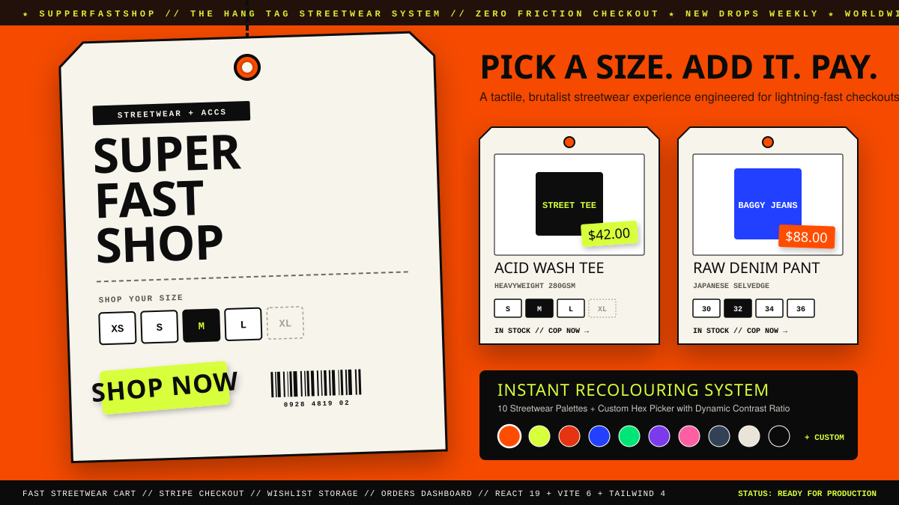

<h1 align='center'>🏷️ supperFastShop – Streetwear & Accessories Platform</h1>

<p align="center">
  <strong>A high-speed, brutalist streetwear store engineered around "The Hang Tag" design system.</strong><br>
  Built with React 19, Vite 6, Tailwind CSS v4, Zustand 5, Express, MongoDB, and Stripe.
</p>

---

## 📸 Preview



---

## 🎯 The Hang Tag Design System

`supperFastShop` departs from conventional cookie-cutter photo-grid templates. The entire interface adopts the tactile visual language of garment manufacturing and retail drops:

- **Die-Cut Swing Tags**: Clipped corner tags with punched grommet holes, hanging cord strings, and paper stock drop shadows.
- **Woven Care Labels**: High-contrast black-on-white textile labels for categories and micro-metadata.
- **Price-Gun Stickers**: Tilted acid-yellow & neon price stickers functioning as high-visibility call-to-actions.
- **Retail Barcodes & Care Icons**: Functional SVG barcodes and garment wash/care icons acting as structural dividers.
- **Stamped Size Runs**: Interactive size runs (`XS` through `XL`) with ghost dashed cells for sold-out inventory.
- **Tactile Sound & Motion**: Gentle physics-based swing animations with respect for `prefers-reduced-motion`.

---

## 🎨 Themes & Customization

The storefront includes an instant runtime palette recolouring engine powered by CSS custom properties and WCAG-compliant contrast logic:

| Palette | Field Color | On-Field Text | Sticker Color |
|---|---|---|---|
| **Signal Orange** | `#ff4d00` | Ink Black | Acid Yellow (`#d7ff3a`) |
| **Acid Yellow** | `#d7ff3a` | Ink Black | Signal Orange (`#ff4d00`) |
| **Drop Red** | `#e63312` | White | Acid Yellow (`#d7ff3a`) |
| **Cobalt Blue** | `#2340ff` | White | Acid Yellow (`#d7ff3a`) |
| **Cyber Lime** | `#00e676` | Ink Black | Signal Orange (`#ff4d00`) |
| **Hyper Violet** | `#7c3aed` | White | Acid Yellow (`#d7ff3a`) |
| **Bubble Pink** | `#ff5fa2` | Ink Black | Acid Yellow (`#d7ff3a`) |
| **Concrete** | `#334155` | White | Acid Yellow (`#d7ff3a`) |
| **Raw Canvas** | `#eae4d8` | Ink Black | Signal Orange (`#ff4d00`) |
| **Ink Black** | `#0b0b0b` | Paper White | Signal Orange (`#ff4d00`) |
| **Custom Hex** | User Chosen | Auto Contrast | Auto Inverted |

Users can also toggle **Print Grain** (an ink fractal noise overlay) and **Animations** in the Settings tab.

---

## ⚡ Core Features

- ⚡ **Speed-First Shopping Experience**: Fast navigation, zero-friction discovery, and immediate add-to-cart.
- 🔍 **Advanced Shop Search & Filtering (`/shop`)**: Instant query search, category filters, size selector, price range filter, and sorting (newest, price ascending/descending).
- 🏷️ **Product Tag View (`/product/:id`)**: High-res product display, size run selector, sold-out tracking, customer reviews, and related category items.
- 💖 **Wishlist (`/wishlist`)**: Client-side persisted wishlist allowing shoppers to bookmark favorite tags across sessions without requiring login.
- 🛒 **Size-Aware Cart & Coupon System (`/cart`)**: Real-time quantity adjustments, multi-size support per product, and coupon discounts with instant subtotal and savings calculation.
- 💳 **Stripe Checkout**: Integrated Stripe session checkout with animated confetti purchase confirmation (`/purchase-success`) and cancel recovery (`/purchase-cancel`).
- 📦 **Order History & Receipts (`/orders`)**: Dedicated user orders page displaying receipt barcodes, timestamps, item breakdowns with sizes, quantities, and payment totals.
- 📱 **Mobile-First Thumb Dock**: Responsive navigation dock for mobile devices with live badges for cart and saved items.
- 📊 **Admin Dashboard (`/admin-dashboard`)**: Product creation with multi-size allocation and Cloudinary upload, featured status toggling, deletion, and 7-day sales & revenue analytics via Recharts.

---

## ⚙️ Tech Stack

### 🎨 Frontend
- **Framework**: React 19 + Vite 6
- **Styling**: Tailwind CSS v4 + Custom Theme Engine
- **State Management**: Zustand 5 (Cart, Wishlist, User, Theme, Products)
- **Routing**: React Router DOM v7
- **Motion & UI**: Framer Motion, Lucide React, Recharts, React Hot Toast, React Confetti
- **Typography**: Big Shoulders Display, Archivo, Azeret Mono

### 🧱 Backend
- **Runtime**: Node.js & Express.js (ES Modules)
- **Database**: MongoDB with Mongoose ODM
- **Authentication**: JWT in HTTP-only cookies + bcryptjs
- **Payments**: Stripe API
- **Media**: Cloudinary + Multer + Sharp
- **Caching & Sessions**: Redis (ioredis / Upstash)

---

## 🔌 API Endpoints Overview

### 🔑 Authentication (`/api/auth`)
| Method | Endpoint | Description |
|---|---|---|
| `POST` | `/signup` | Register new user account |
| `POST` | `/login` | Authenticate and issue JWT cookies |
| `POST` | `/logout` | Clear auth cookies |
| `POST` | `/refresh` | Refresh access token |
| `GET` | `/getProfile` | Retrieve signed-in user profile |

### 🛍️ Products (`/api/product`)
| Method | Endpoint | Access | Description |
|---|---|---|---|
| `GET` | `/` | Public | Search and filter products (`q`, `category`, `size`, `minPrice`, `maxPrice`, `sort`, `page`) |
| `GET` | `/all` | Admin | Retrieve all products for admin management |
| `GET` | `/featured` | Public | Get featured products for homepage drops |
| `GET` | `/recommendtion` | Public | Get recommended products |
| `GET` | `/category/:category` | Public | Filter products by category |
| `GET` | `/:id` | Public | Get single product detail with related items |
| `POST` | `/` | Admin | Create product with image upload and size configuration |
| `PATCH` | `/:id` | Admin | Toggle product featured status |
| `DELETE` | `/:productId` | Admin | Delete a product |

### 🛒 Cart (`/api/cart`)
| Method | Endpoint | Access | Description |
|---|---|---|---|
| `GET` | `/` | User | Get items in user cart |
| `POST` | `/` | User | Add item to cart (with size & quantity) |
| `PUT` | `/:id` | User | Update quantity for product and size |
| `DELETE` | `/` | User | Remove item from cart or clear entire cart |

### 📦 Orders (`/api/orders`)
| Method | Endpoint | Access | Description |
|---|---|---|---|
| `GET` | `/mine` | User | Fetch signed-in shopper's order history |

### 💬 Reviews (`/api/reviews`)
| Method | Endpoint | Access | Description |
|---|---|---|---|
| `GET` | `/:productId` | Public | Fetch reviews and rating breakdown for product |
| `POST` | `/:productId` | User | Submit a review with star rating and comment |

### 🎟️ Coupons (`/api/coupons`)
| Method | Endpoint | Access | Description |
|---|---|---|---|
| `GET` | `/` | User | Get available coupon for user |
| `POST` | `/validate` | User | Validate and apply discount code |

### 💳 Payments (`/api/payment`)
| Method | Endpoint | Access | Description |
|---|---|---|---|
| `POST` | `/create-checkout-session` | User | Generate Stripe checkout session |
| `POST` | `/checkout-success` | User | Confirm payment and record finalized order |

### 📊 Analytics (`/api/analytics`)
| Method | Endpoint | Access | Description |
|---|---|---|---|
| `GET` | `/` | Admin | Fetch overall platform metrics and 7-day revenue/sales trends |

---

## 🚀 Getting Started

### 1. Clone the Repository
```bash
git clone git@github-personal:ExploreInsight/supperFastShop.git
cd supperFastShop
```

### 2. Install Dependencies
```bash
# Install root/backend dependencies
npm install

# Install client dependencies
npm install --prefix client
```

### 3. Setup Environment Variables
Create a `.env` file in the `server` directory:
```env
PORT=7001
MONGO_URI=your-mongodb-uri
JWT_SECRET=your-jwt-secret
ACCESS_TOKEN_SECRET=your-access-token-secret
REFRESH_TOKEN_SECRET=your-refresh-token-secret
CLOUDINARY_NAME=your-cloudinary-name
CLOUDINARY_API_KEY=your-cloudinary-key
CLOUDINARY_SECRET=your-cloudinary-secret
STRIPE_SECRET_KEY=your-stripe-secret-key
CLIENT_URL=http://localhost:5173
UPSTASH_REDIS_URL=your-redis-url
```

In `client/.env` (optional):
```env
VITE_STRIPE_PUBLISHABLE_KEY=your-stripe-publishable-key
```

### 4. Run the Development Servers
```bash
# Start backend server
npm run dev

# In another terminal, start Vite frontend
cd client && npm run dev
```

The client will be running at `http://localhost:5173` and the API at `http://localhost:7001`.

---

## 🏗️ Production Build

To build the client for production:
```bash
npm run build
npm start
```

---

### 👨‍💻 Author
**Chirag**
